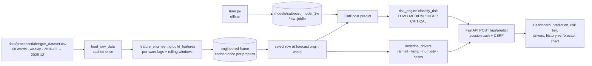

# ARCHITECTURE — AEDISIGHT

Ward-level dengue early warning: weekly weather + case history → CatBoost forecast 2 or 4 weeks ahead → risk tier + drivers in a web dashboard.

## 1. System data flow

Text version: `CSV → features (grouped by ward_id) → origin-week row → CatBoost (2w or 4w) → risk tier → JSON → dashboard`.

## 2. Weather lag pipeline (multi-week, per ward)
All features are built with `groupby("ward_id")`, so no information leaks between wards, and every rolling window uses `shift(1)` so a row never sees its own future.

| Group | Features |
|---|---|
| Lags 1–4 weeks | rainfall, avg temperature, humidity, dengue cases |
| Rolling (prev 2/4/8 wks) | rainfall mean + sum; temperature, humidity, dengue-case means |
| Trend | dengue change 1/2/4 wk, growth ratios |
| Seasonality | ISO week, month, sin/cos encodings |
| Ward vulnerability | `population_density_sqkm`, `water_logging_risk_index`, `sanitation_score`, `city`, `ward_id` |

The 1–4 week rainfall lags match the 7–14 day mosquito breeding cycle plus incubation (2–4 week rain→case delay).
The same function (`src/feature_engineering.py`) is imported by `train.py` and `predict.py`, so training and serving cannot drift.

## 3. Chronological validation split
Targets are `dengue_cases` shifted −h weeks per ward (h = 2, 3, 4). Rows are split by **target date**, never randomly:

- **Train:** target date ≤ 2024 (2016–2024)
- **Test:** target date in 2025 (fully held out, later in time than all training data)

`train.py` reports MAE and RMSE on the 2025 test set against two baselines (training mean, and "last week's cases") and writes them to `models/metrics.json`.

## 4. Model selection rationale
- **CatBoost regressor**: mixed categorical (`city`, `ward_id`) and numeric tabular data; native categorical handling avoids one-hot blow-up across 60 wards; strong on ~30k rows without heavy tuning.
- **One model per horizon (2w, 4w)** (direct forecasting) instead of recursive prediction, so errors do not compound.
- Case counts are zero-inflated (~58 % zeros) and strongly seasonal (peak Jul–Sep, ≈0 in Nov–Mar). Seasonal features and recent-case features let the model capture this; a forecast near 0 in the dry season is correct behaviour.
- Rejected: plain linear/ARIMA (no ward covariates, poor with zero-inflation); deep sequence models (too little data, slower, harder to explain to health officers).

## 5. Risk tiers
For each ward, thresholds are the 50th / 75th / 90th percentiles of weeks with cases > 0, using only data up to the forecast origin (no look-ahead). Forecast ≤ p50 → LOW, ≤ p75 → MEDIUM, ≤ p90 → HIGH, above → CRITICAL; a forecast under 1 case is always LOW.
These are prototype ward-relative bands, **not** clinically validated alert thresholds.

## 6. Compute & API cost controls
| Control | Where |
|---|---|
| Serialized models (joblib), loaded once with `lru_cache`; 2w/4w loaded lazily | `src/predict.py` |
| Raw data and engineered features computed once per process, not per request | `load_raw_data`, `load_engineered` |
| Per request: one row selection + one CatBoost `predict` (milliseconds) | `generate_forecast` |
| **No external API calls at inference**: no weather API, no LLM → $0 per request, 0 tokens | whole system |
| Debug logging off by default (`DEBUG_PREDICTIONS=1` to enable) | `src/predict.py` |
| Session auth + CSRF on the prediction endpoint; Pydantic validation rejects bad input before any compute | `main.py` |
| Training is offline and one-off (~minutes on CPU); no GPU needed | `train.py` |

If live weather or LLM summaries are added later: cache weather per (city, week), batch ward requests, and cap tokens per summary.

## 7. Limitations & next steps
- Forecasts are made from a selectable origin week in the historical dataset (backtest mode, shows actual cases when available); no live weather or hospital feed yet.
- Add prediction intervals (quantile CatBoost) and a validation-error dashboard (MAE/RMSE per ward/month).
- Replace percentile tiers with thresholds agreed with public-health authorities.
- Driver text describes observed inputs; per-prediction SHAP values would give true model attribution.
